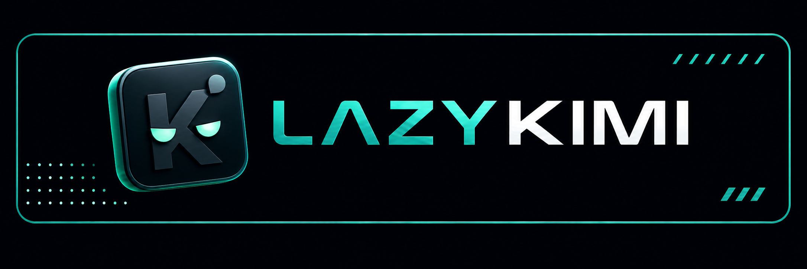
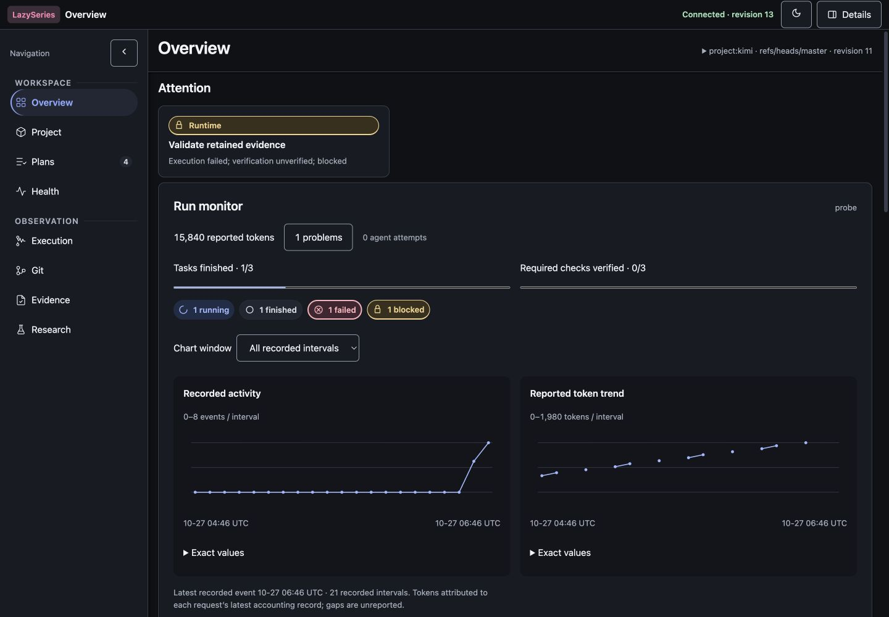
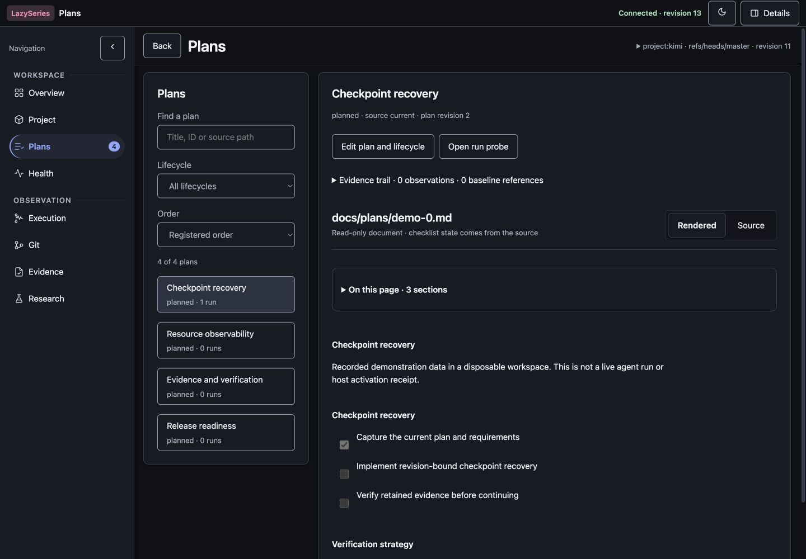
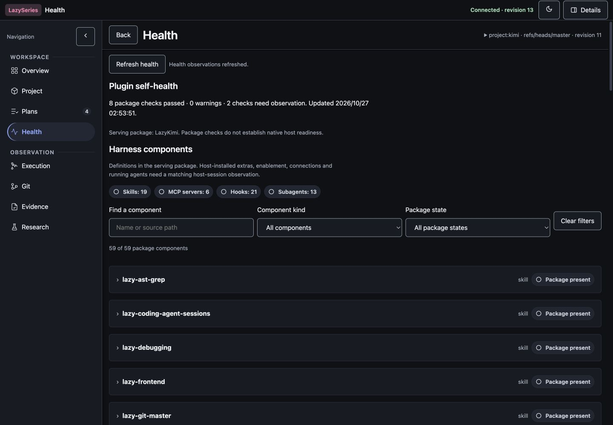

# LazyKimi



[](RELEASE_NOTES.md)
[](LICENSE)
[](#lazyseries-family)

**Describe the work. Keep the plan. Prove the result.**

LazyKimi brings structured, evidence-based workflows to **Kimi Code CLI**.
Kimi Work is a secondary, experimental full-plugin route with a skills fallback.
Kimi Code for VS Code, IDE integration through ACP, and **Kimi Code Desktop**
are separate acceptance targets. Kimi Code Desktop and Kimi Work are distinct
products; see the [surface guide](docs/reference/kimi-product-surfaces.md).

[Platform status](docs/reference/platform-status-2026-10-27.md) · [Get started](#recommended-install-with-ai-help) · [Host routes](#choose-one-route) ·
[1.4.0 notes](RELEASE_NOTES.md) · [Family](#lazyseries-family) · [Docs](docs/)

> **Current package version: v1.4.0. HOST READINESS: PENDING.** Local checks and release
> archives prove package behavior; a fresh host session must prove loading,
> command/skill execution and MCP connections.

## What's in 1.4.0

- An authenticated local dashboard with eight destinations: **Overview, Project,
  Plans, Health, Execution, Git, Evidence and Research**.
- A project record, editable plans, queue planning and research capture, with
  source revisions and evidence references visible for review.
- A run monitor that separates execution progress from verified completion,
  plus reported token usage, resource activity and retained-run history.
- A Health inventory of package components, separate from observed host activity.

The `status-dashboard` MCP server exposes seven tools, including
`dashboard_service`, `copy_task_context` and typed `project` operations.

Manifest MCP launchers still require explicit project binding. The 19 inline
hook declarations do not establish current-build hook cwd or delivery.

The release builds on the existing planning, decision-memory and verification
workflows described below. No speed, token-saving or cost improvement is
claimed. See the [release notes](RELEASE_NOTES.md) for compatibility and upgrade
boundaries; historical changes remain in `CHANGELOG.md`.

## Browser dashboard (v1.4.0)

After explicit project initialization, the dashboard provides **Overview,
Project, Plans, Health, Execution, Git, Evidence and Research** in a collapsible
sidebar. Contextual Details keep the selected item in view; maps support pan,
zoom and an expanded modal. Theme and density preferences persist, and
navigation guards protect unsaved edits.

Execution progress and verification are separate. Token charts, resource
activity and retained-run comparisons show available records; missing usage
remains unknown. Health lists package Skills, commands, agents, hooks and MCP
components without treating that inventory as host activation.

Plans and research expose source revisions and evidence references. A hash
reference does not preserve an immutable copy of its source or verify a
finding. Source edits require authentication, the correct native project
binding and a matching revision; stale edits conflict instead of overwriting
newer work. Queue edits never start execution.

The service binds to authenticated loopback, and each repository keeps its own
project state. Browser access, transactional edits, queue planning, context
copy and observations are package capabilities. Host embedding, chat handoff
and wake remain unobserved; **HOST READINESS: PENDING** still applies.

The portable dashboard and project cores are pinned in
`lazykimi-plugin/shared/dashboard.vendor.json` and
`lazykimi-plugin/shared/project.vendor.json`. The
[learning path](docs/00-learning-path.md) covers package architecture and usage.

### Dashboard gallery

Recorded demo data served by the native local dashboard; not a live host-session receipt.

**Overview** — execution and verification progress, recorded activity and the project map.



**Plans** — plan records, source context and revision-aware review.



**Health** — package component inventory, separate from observed host activity.



### Just ask, or use a command — both work

Two entry routes converge on the same execution authority and gates:

- **Natural language**: describe the work plainly — "Fix the typo in the
  welcome label" — and the smallest sufficient workflow is selected and run.
- **Explicit entry**: on the manifest route, `/lazykimi:lazy-ulw-plan <idea>` and `/lazykimi:lazy-start-work <plan>` invoke plugin commands. On the project skills route, use `/skill:lazy-ulw-plan` and `/skill:lazy-start-work`. These routes remain subject to host observation.

No slash command is required for a clear implementation request. Conversely,
asking to *explain*, quoting a command, or saying "plan only" never touches
your files: the persisted `execution_intent` stays `plan_only` until you
actually ask for execution, and a vague "ok" with several open questions never
grants execution by itself.

### Plans you can edit while work runs

Plans are Markdown you own. Edit them mid-run; the harness reconciles your
changes at execution boundaries instead of overwriting them:

- Cosmetic wording and ordering edits preserve existing evidence.
- Semantic edits (acceptance, dependencies, verification commands) invalidate
  only the affected task and its dependents — unrelated work is untouched.
- Your checkbox is an *assertion*, not a verdict: a checked box alone never
  counts as verified completion, and unchecking reopens the task.

### Decisions the harness remembers

Cross-plan decisions live in a durable ledger (`.lazykimi/decisions/ledger.jsonl`).
When plan two hits a question plan one already answered — with evidence — it
recalls the decision instead of re-asking you. Contradictions are surfaced as
supersessions, defects become scoped corrections that block only the affected
work, and nothing in memory can override your current instructions.

### Verification sized to the change

The workflow calls for verification sized to the change: a documentation
inspection (V0), a focused check (V1), an integration scenario (V2), or a
comprehensive security/release gate (V3, normally in CI). Valid evidence may be
reused while its inputs match; affected, missing or stale checks must rerun.
Native execution still needs acceptance in the selected host.

Milestones, decision gates, and full state/version semantics are shared
byte-identically with its sibling ports (see
`lazykimi-plugin/contracts/lazyseries-shared-semantics.v1.json`).

## Recommended: install with AI help

Open an AI coding assistant in your project and paste this:

> Help me install LazyKimi from https://github.com/elvinzhao10/LazyKimi for
> this project. Read AGENTS.md and the current install guide. Use the
> versioned v1.4.0 source and run safe
> package checks first, choose one explicitly project-bound route, and ask me
> before changing plugins, global hooks, MCP, credentials or trust settings.

The assistant can guide onboarding; approve each host-managed change.

## Manual setup

Use **Node.js LTS 24 (recommended) or 22**, **Git**, and **Python 3.10+**
for the MCP servers. The lifecycle also accepts Node.js 20 for compatibility.
Follow [AGENTS.md](AGENTS.md) and the
[installation guide](docs/03-install-and-host-verification.md).

Use the published `v1.4.0` release for the current package and build instructions.
Clone the versioned source:

```bash
git clone --branch v1.4.0 https://github.com/elvinzhao10/LazyKimi.git
cd LazyKimi
```

Source checkouts need a CLI build; the release archive includes it:

```bash
cd lazykimi-plugin
npm ci --ignore-scripts --no-audit --fund=false
npm run build
node dist/index.js load-check
node dist/index.js doctor
```

`load-check` is the bare-extraction verification entry: it needs no bound
project. `doctor` is project-scoped — in a bare extraction it exits 1 with
init guidance until `lazykimi init` has bound the selected project.

Run `lifecycle onboard` for a durable installation. Use its stable launcher
for later status, update and receipt-safe offboard, with the selected project:

```text
node "<install-root>/LazyKimi/launcher.js" lifecycle status --project "<absolute-project-root>"
```

## What “ready” means

- **Package readiness** means copied files, declarations and local checks pass.
- **Host readiness** requires a fresh selected-host session, one real skill or
  command, hook observations where supported, and all six MCP connections.

Until observed, **HOST READINESS: PENDING**. Package fixtures and macOS source
checks do not prove IDE, desktop, Linux or Windows acceptance. Do not turn
native `/swarm`, `/goal` or `/plan` availability into a LazyKimi acceptance claim.

## Choose one route

### Identify the Kimi client first

| Name | What it means | LazyKimi acceptance |
| --- | --- | --- |
| Kimi Code CLI | Coding agent launched with `kimi` in a terminal. | Primary package target; current native host session still pending. |
| Kimi Code for VS Code | Official editor extension with a Kimi panel and code review UI. | Separate extension/CLI build acceptance pending. |
| Kimi Code in an ACP IDE | An editor such as Zed or JetBrains launches `kimi acp`. | CLI-backed integration; editor session acceptance pending. |
| Kimi Code Desktop | Standalone graphical coding client for local projects. | Shares documented CLI extension settings; package acceptance pending. |
| Kimi Work | Work mode of the general Kimi desktop app, for local knowledge work. | Experimental full-plugin route; skills-only fallback remains narrower. |

“Kimi Code IDE” is a broad description, not a sufficient installation target.
Record the editor/extension or ACP path and exact host build. The current
[CLI migration guide](https://www.kimi.com/code/docs/en/kimi-code-cli/guides/migration.html)
also distinguishes the Node.js client from legacy Python `kimi-cli`; old
client evidence does not establish new-client compatibility. Product facts and
sources are in the [surface guide](docs/reference/kimi-product-surfaces.md).

| Route | Package behavior | Remaining acceptance |
| --- | --- | --- |
| Kimi Code CLI project init | `lazykimi init` creates explicitly bound project MCP configuration; the hook helper installs eight critical hooks in the selected Kimi config. | Fresh session loading, command/skill use, hooks and MCP. |
| Kimi plugin manifest | Declares skills, commands, agents, nineteen hooks and six MCP launchers. Unbound project-state MCP fails closed. | Full plugin acceptance and supported request-context project binding. Use the project route for bound MCP. |
| Kimi Work | Experimental full plugin; fallback imports skills and uses manual MCP configuration. | Full plugin loading, agents, commands, hooks and project binding. Fallback excludes commands, agents and hooks. |

Choose one route per project; combining manifest and project routes may fire
hooks twice. Respect `KIMI_CODE_HOME` when selecting global configuration.

Kimi Work's host supports broader plugin components according to the
[official overview](https://www.kimi.com/en/help/plugins-and-skills/overview).
That does not establish this package's full support. Kimi web supports skills
and MCP; it is not a full local LazyKimi installation route. See the
[Work guide](docs/11-kimi-work-setup.md) for the fallback limits.

## Design mindset

Start with the result you want and how you will know it worked. Then use the
smallest amount of structure that fits the task. You can simply describe the
work in plain language; the modes are guidance, not commands you need to
memorize. The v1.3.0 dual-entry routing picks one of these for you.

| Mode | Use it when | Example request |
| --- | --- | --- |
| Direct | The change is small and clear. | “Fix this error and run the relevant test.” |
| Assisted | You need help understanding an unfamiliar area or failure. | “Help me find why this command fails, then verify the fix.” |
| Planned | The work has several parts or important choices. | “Make a plan for this feature before changing files.” |
| Orchestrated | The work affects a release, security, or a risky change. | “Review this release and prepare it for publication.” |
| Long-horizon | The goal needs to continue across sessions. | “Keep working on this migration with checkpoints.” |


## Keep host changes deliberate

LazyKimi does not automate credentials, OAuth values, private registries, or
trust settings. It asks for approval before any host-managed action and keeps
safe package checks separate from marketplace and connector changes.


## Package inventory

These counts describe shipped definitions and declarations, not loaded host
components.

| Surface | Count | Role |
| --- | ---: | --- |
| Skills | 19 | Host-facing workflow policies for planning, execution, review, and verification. |
| Commands | 20 | Named host entry points for those workflow policies. |
| Agents | 13 | Family role definitions; host selection and delegation require current-session observation. |
| MCP declarations | 6 | Local services for ledger, verification, status, context, code intelligence, and docs (35 tools). |
| Hooks | 19 | Hook event declarations; the critical 8 install into `~/.kimi-code/config.toml`, all 19 ride the plugin manifest (TurnStarted, UserPromptQueued and TaskStarted adopted from the 2026-10-18 rescan as advisory manifest-only consumers). |


## LazySeries family

**One workflow philosophy. Six host integrations.** Choose the sibling for the
host you use; each keeps its own native adapters, installation route and
acceptance evidence. These packages run independently.

| Sibling | Target host |
| --- | --- |
| [LazyBuddy](https://github.com/elvinzhao10/LazyBuddy) | CodeBuddy CLI / IDE · WorkBuddy |
| [LazyTrae](https://github.com/elvinzhao10/LazyTrae) | TraeCode / TraeWork / TraeCode CLI |
| [LazyQoder](https://github.com/elvinzhao10/LazyQoder) | Qoder CLI / IDE / app |
| [LazyZCode](https://github.com/elvinzhao10/LazyZCode) | ZCode |
| [LazyKimi](https://github.com/elvinzhao10/LazyKimi) **← you are here** | Kimi Code CLI · Kimi Work (experimental) |
| [LazyDeepSeek](https://github.com/elvinzhao10/LazyDeepSeek) | DeepSeek Harness 0.2.1-rc.3 |

The family shares planning, evidence, decision-memory and completion contracts.
The first shared verification core is vendored in every package, and since v1.4.0 the shared dashboard core is vendored the same hash-pinned way; product adapters keep host setup and permissions explicit. Matching contracts do not make host capabilities interchangeable. In particular,
Kimi Work remains experimental for LazyKimi, and DeepSeek's synthesized events
are not native hooks. Use each sibling's host guide before installation.

## Technical reference and evaluation

The [documentation index](docs/) explains the package, state model,
security boundaries and MCP lifecycle. The
[plugin README](lazykimi-plugin/README.md) contains detailed routes and CLI use.
The [evaluation](lazykimi-evaluation.md) separates package checks from host evidence.

Root community files and `docs/` are regular publication copies, not symlinks.
The installable payload is `lazykimi-plugin/`. Optional local reference clones
under `sources/` are git-ignored and are not distributed with this repository.

LazyKimi follows the LazyCodex workflow design and its sibling implementations.
[NOTICE](NOTICE) records attribution; no sibling or upstream project is a runtime dependency.

## Learn more

- [Install and verify a host](docs/03-install-and-host-verification.md)
- [Remove receipt-owned assets safely](docs/08-safe-removal.md)
- [Workflow playbooks](docs/04-workflow-playbooks.md)
- [Evidence and completion](docs/05-evidence-and-completion.md)
- [Host routes and recovery](docs/reference/host-routes.md)
- [Kimi Work setup](docs/11-kimi-work-setup.md)
- [Release notes](RELEASE_NOTES.md)
- [Documentation index](docs/)

## License

[MIT](LICENSE). See [NOTICE](NOTICE) for attribution and provenance.

## Contributing

Issues and pull requests are welcome. Read [CONTRIBUTING.md](CONTRIBUTING.md)
for development checks and sanitized reproduction guidance. Report
vulnerabilities privately according to [SECURITY.md](SECURITY.md).
